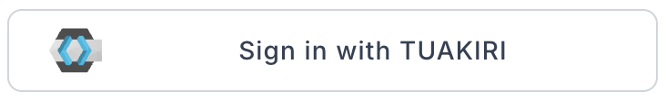

In this tutorial you log in to the [REANNZ HPC Portal](https://hpc-portal.reannz.co.nz)
and find your way around it.
You look, but you do not change anything, so you cannot break anything.

It takes about 10 minutes.
By the end you will know where your projects, team and allocations live.

!!! info "Before you start"
    At present only members of Public Research Organisations can use the HPC Portal.
    Everyone else should keep using [my.nesi.org.nz](https://my.nesi.org.nz).

    You need an account at an institution in the Tuakiri federation.
    If your institution is not part of Tuakiri, see
    [Account Requests for non-Tuakiri Members](https://docs.nesi.org.nz/Policy/Account_Requests_for_non_Tuakiri_Members/).

## Log in

1. Go to [https://hpc-portal.reannz.co.nz](https://hpc-portal.reannz.co.nz).
2. Click **Sign in with Tuakiri**.
    
3. Choose your home institution and log in with your institutional credentials.
   This is the same login as for my.nesi.org.nz.

The portal opens your **User dashboard**.

If you cannot log in, see
[Logging in to my.nesi.org.nz](https://docs.nesi.org.nz/Getting_Started/my-nesi-org-nz/Logging_in_to_my-nesi-org-nz/#troubleshooting-login-issues).

## See your roles

Find the **Roles and permissions** table on your dashboard.
Each row is one role you hold.

Look at the **Role name** column. You will see one or more of:

- *Project member* – you work on someone else's project.
- *Project manager* – you lead a project, usually as its principal investigator (PI).
- *Organisation owner* – you are an access enabler: you manage HPC access for your institution.

Note your roles. They decide what you can do and which guide you follow next.

!!! tip "No roles yet?"
    An empty table means you have no role yet.
    You get a role when someone adds you to a project, or when you request one.
    Finish the tour, then go to your [onboarding path](#next-steps).

## Find your way around

Look at the sidebar on the left. Its main sections are:

- **Organisations** – the institutions you belong to.
- **Projects** – every project you are a member of.
- **Resources** – your allocations, grouped by type.
- **REANNZ Marketplace** – the services on offer.

Now look at the top of the page.
The breadcrumb shows where you are.
Your name menu, top right, holds your profile and the option to log out.

## Open a project

1. Click **Projects** in the sidebar.
   Each card shows a project's name, **Organisation**, **Resources** and **End date**.
2. Pick a project and click **Details**.

You are now on the project page.
Look at the breadcrumb: it reads *Organisations / your institution / your project*.

Click through the four tabs: **Project dashboard**, **Resources**, **Team** and **Audit logs**.

If **Projects** is empty, skip to [Next steps](#next-steps).

## See who is on the team

1. On the project page, click the **Team** tab.
2. Find yourself in the **Active** list.
   Check your **Role in project**.
3. Look under **Invitations**.
   These are people invited who have not joined yet.

## Open a resource

A resource is an allocation the project holds, for example compute on Mahuika or storage on Freezer.

1. Click the **Resources** tab.
2. Click a resource to open it.
3. Find the **Termination date**. This is when the allocation ends.
4. Find current usage against each limit, then the **Usage history** chart.
5. Click **Actions** to see what you can do.
   Close the menu without choosing anything.

The options under **Actions** depend on your role.

## What you learned

You can now:

- log in with Tuakiri;
- read your roles on the **User dashboard**;
- open a project and its **Team** tab;
- open a resource and find its end date and usage.

## Next steps

Pick the onboarding path for your main role:

- *Project member*: [Project member path](../members/index.md)
- *Project manager*: [Project manager and PI path](../project-managers/index.md)
- *Organisation owner*: [Access enabler path](../access-enablers/index.md)

To learn how projects, resources and orders fit together, read
[How the HPC Portal works](how-the-portal-works.md).
To look up a screen or role, see the [Portal reference](portal-reference.md).
